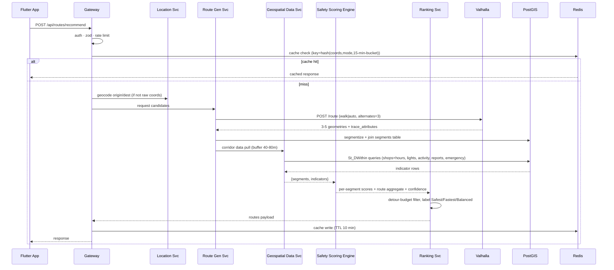
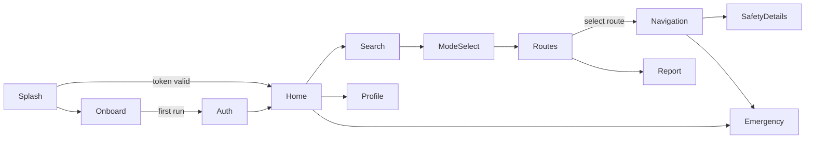

# NightWise — Intelligent Women's Night Safety Navigation System
## Technical Implementation Plan & Engineering Blueprint

**Document version:** 1.0 · **Date:** Nov 2026 · **Scope:** Bengaluru MVP
**Audience:** Development team (2–4 engineers) using this as the primary build blueprint.

---

# 1. Executive Summary

NightWise is a safety-aware navigation platform that reorders route options by *environmental safety indicators* rather than travel time. The MVP covers **walking** and **vehicle (car/two-wheeler)** modes within Bengaluru.

**The core architectural insight of this project:** routing is a *solved problem*. Valhalla (OSS) generates the candidate routes; our differentiator — and the entire engineering effort concentrates here — is a **segment-level safety scoring engine** that consumes three data planes:

1. **Static geospatial plane** — road graph, streetlights, POI/locations, emergency services, pedestrian infrastructure, stored in PostgreSQL/PostGIS.
2. **Temporal plane** — business opening hours, time-of-day activity profiles, hour-of-week context.
3. **Dynamic/community plane** — user safety reports, data freshness, data provenance (verified vs estimated).

The recommendation pipeline: **geocode → candidate routes (Valhalla) → segment the geometry → spatially join segment buffers against the data planes → score each segment (weighted, uncertainy-aware, length-weighted, *risk-dominant* aggregation) → rank routes with detour constraints → return safest/fastest/alternatives with explicit confidence and uncertainty**.

Key non-negotiable product principles, encoded into the architecture:

- **Never a guarantee.** Scores are environmental *estimates*, output with a data-confidence field and uncertainty warnings. "Low confidence — this street has no verified lighting data" is shown the same way as a low score.
- **Unknown ≠ unsafe, unknown ≠ safe.** Missing data produces *low confidence*, not a score of zero or hundred.
- **Risk-dominant segments.** A route's score can be dragged down by its worst stretch — a single well-lit mile cannot mask a dark, isolated 800 m gap (see §9).
- **Privacy-minimal.** No persistent per-user location history; route history is opt-in, coarse, and ephemeral.
- **Open-source-leaning stack.** Valhalla + OSM + PostGIS + MapLibre keeps per-request costs near zero and gives full control over scoring; Google Places is used surgically for POI hours only where licensed budget allows.

**MVP definition (what "done" means for v1):** a Flutter app that, inside the Bengaluru valley area, returns 3–5 candidate routes for walking/vehicle, each with distance, ETA, and a 0–100 safety score with per-indicator breakdown, segment map coloring, and confidence labels — driven by a data pipeline that has ingested OSM roads, community/OSM POIs, verified streetlight data (partial coverage is accepted and labeled), emergency services, and police/hospital locations.

---

# 2. Problem Statement and Objectives

## 2.1 Problem

At night, women in Bengaluru face safety risk that correlates strongly with environment: dark unlit stretches, closed commercial frontage, empty streets, poor last-mile access. Standard navigation (Google Maps, etc.) optimizes time/distance and is largely blind to these dimensions. There is no mainstream tool that answers: *"Which of these four routes home is Most comfortable and visible at 10 PM tonight?"*

## 2.2 Objectives

| # | Objective | Measurable MVP success criterion |
|---|-----------|--------------------------------|
| O1 | Generate time-aware, mode-aware safety-scored route options | ≥3 candidate routes per request, scored in <3 s p95 |
| O2 | Multiply-interpretable safety breakdown | Every score decomposable into streetlight/shop/activity/community components with raw data counts behind each |
| O3 | Honest data handling | Coverage/confidence surfaced per route; no silent zeros |
| O4 | Support walking + vehicle semantics distinctively | Vehicle mode never proposes footpaths; walking mode penalizes isolated stretches harder |
| O5 | Deployable in Bengaluru with partial data | Works acceptably where streetlight coverage exists, degrades gracefully and *visibly* where it doesn't |
| O6 | Privacy-first | No default location history retention; reports pseudonymous |

## 2.3 Explicit non-goals (MVP)

- Live CCTV/video-based assessment (explorable later; regulatory + infra infeasible now).
- Real-time "companion" / SOS dispatch integration with police sysktems (Phase 2+; static emergency-location data ships in MVP).
- Crowdsourced *incident streams* beyond structured reports.
- Panic/companion tracking — later phase requiring dedicated safety design.
- City expansion beyond Bengaluru.

---

# 3. Functional Requirements

FR-IDs are used throughout later sections for traceability.

### FR-A: Route Recommendation (FR-101..FR-109)
- **FR-101** Accept origin, destination, mode (`walk` `vehicle`), departure time; return ≥3 ranked route options.
- **FR-102** Each route: polyline geometry, distance, estimated duration, overall safety score (0–100), confidence (0–1), per-indicator breakdown, warnings.
- **FR-103** Distinguish and label: **Safest**, **Fastest**, **Balanced**; show trade-off text ("+6 min over fastest, +14 safety points").
- **FR-104** Route geometry split into segments ≤250 m (visualized with per-segment risk color).
- **FR-105** Time-dependent scoring: shop availability evaluated at departure time; lighting evaluated after sunset hours.
- **FR-106** Detour constraints: safety-first options may exceed fastest by ≤ configurable detour budget (walk: +8 min / factor 1.4; vehicle: +5 min / factor 1.25).
- **FR-107** Show live position along route in navigation screen.
- **FR-108** Warn explicitly jitter: `uncertain_data` warnings listing lacked indicators per segment.
- **FR-109** Rate limiting + abuse protection on all endpoints.

### FR-B: Environmental Safety Analysis (FR-201..)
- **FR-201** Open/active shops within a corbuffer of each segment: density per km, nearest active POI distance, boundary with current time + weekday.
- **FR-202** Unknown hours must NOT be treated as closed; produce `hours_known: false` and contribute activity score via *prior* rather than zero.
- **FR-203** Streetlight coverage: lights per 100 m, max gap between lights, fraction of segment lit (illumination radius model), time-of-night factor.
- **FR-204** Route popularity/activity proxy: OSM `traffic`/`lit`/cadestral density, POI density, residential density, aggregated per-road activity priors; optional Google-heavy "popularity" only where budgeted.
- **FR-205** Extra indicators: isolation (residential+POI density low), nearest police stations/emergency services hospitals, road accessibility, road crossing (lacking)焦虑.
- **FR-206** Community reports: aggregate severity-weighted, decrypted anonymity; reports freshness-decay (halves in 30 days), conflict-with-data flag.

### FR-C: Emergency & Reporting (FR-301..)
- **FR-301** Show nearest police stations/emergency services hospitals with phone no distance.
- **FR-302** One-tap call to police (100)/112/emergency contacts.
- **FR-303** Report submission types: `harassment` `poor_lighting` `unsafe_isolated` `no_footpath` `construction` `other`; optional location, note, timestamp.
- **FR-304** Moderation queue → published reports feed scoring within configured SLA (target ≤24h).

### FR-D: User & Settings (FR-401..)
- **FR-401** Phone-OTP-free MVP auth: email+password with JWT; phone/OTP Phase 2.
- **FR-402** Bubble: mode preference defaults, safety vs time trade-off slider (affects ranking weights client-side result), accessibility preference (avoid steps → affects walking profile), saved routes (max 2, hashcoped).
- **FR-403** View/Delete own data (reports, saved routes).

---

# 4. Non-Functional Requirements

| Category | Requirement |
|----------|-------------|
| **Performance** | Route recommendation p95 < 3 s (server-side, excluding network). Score DB query < 500 ms via GiST-indexed buffers + Redis cache. |
| **Scalability** | Stateless Express services (horizontally scalable); PostGIS sized for ~80k OSM ways + ~50k POIs + 3k lights (Bengaluru MVP) — modest; path to 10x without redesign. |
| **Availability** | Degradation-first: if Valhalla up but PostGIS empty of lights → still serve routes with `zero lights data` warning rather than failing. External API outage → cached/fallback data, explicit banner. |
| **Privacy** | No default per-user location retention; routes computed ephemeral; community reports pseudonymous (hashed client fingerprint); opt-in coarse history (100 m drill-down only). |
| **Security** | HTTPS only; JWT access 15 min + refresh 30d rotating; bcrypt (cost 12); input validation via zod/joi at boundary; rate limit (per IP + per user). |
| **Observability** | Structured JSON logs (pino), request IDs, Sentry for errors, Prometheus metrics `/metrics`, uptime probe. |
| **Integrity** | Every data ingestion run stamped in `data_sources` (`last_synced`, row counts, failures). Scores carry `confidence` derived from data-plan coverage. |
| **Accuracy** | Field validation protocol (§16) before public release: ≥30 audited night-time street audits comparable to system scores. |
| **Cost** | Target < $60/mo infra (one VPS/managed Postgres), OpenStreetMap-derived data near-free, Google API spend capped with policy fallback to OSM. |
| **Accessibility** | WCAG AA contrast; score rendering not color-alone (icons+text); screen-reader labels for map annotations. |

---

# 5. Technology Stack and Justification

## 5.1 Frontend

| Component | Choice | Why | Alternatives rejected |
|---|---|---|---|
| Framework | **Flutter + Dart** | Single codebase (Android+iOS), strong maps stack (`maplibre_gl` plugin), good offline & background-location support | React Native (weaker gometry/map story) |
| Map SDK | **MapLibre GL Native** (`maplibre_gl` Flutter plugin) | Free, no per-MAU billing, vector tiles → cheap custom styling (satefiy-heat / dark night mode a first-class need), full polyline/annotation control | **Google Maps SDK**: render cost-at-scale billing, closed styling; on-device cost zero though. *Recommendation: MapLibre + free vector tiles (OpenFreeMap / self-hosted tiles from OSM via Tilemaker). Keep a thin `MapAdapter` interface so a Google backend is a 1-class swap if product later needs Google POI richness on the client.* |
| State | **Riverpod (v2, codegen)** | Compile-safe DI, fine-grained providers (perfect for "request in flight → routes → selected route → navigation" state machine), testable without widgets | **Bloc**: heavier ceremony, event-class boilerplate; fine choice but slower iteration for a 2–4 person team |
| Networking | `dio` + generated clients from OpenAPI | Type safety from the shared backend spec | — |
| Location | `geolocator` + `permission_handler` | Standard; handle "while-in-use" only (no background needed for MVP nav) | — |

## 5.2 Backend

| Component | Choice | Why |
|---|---|---|
| Runtime | **Node.js 20 LTS + TypeScript** | Team skill alignment stated in the prompt; TS catches the scoring-math class of bug; Express ecosystem is mature for middleware (validation, rate-limit, auth) |
| Framework | **Express 4** | Explicitly requested; thin routing layer. Keep *all* business logic in service modules so transport layer is replaceable |
| Validation | `zod` + `express-zod` wrapper | Single schema → typed input + OpenAPI docs |
| ORM/Query | **`pg` + raw SQL + thin repository layer** (no heavyweight ORM) | Geospatial work (ST_DWithin, buffers, lateral joins) is far cleaner in raw SQL; retain types at repository boundaries |
| Auth | `jsonwebtoken` + `bcrypt` | — |
| Rate limit/abuse | `rate-limiter-flexible` backed by Redis | — |
| Logging | `pino` + `pino-http` | Structured, fast, epiphany-ready |
| Jobs | **`pg-boss`** (Postgres-based queue) | One less service vs RabbitMQ; adequate for data refresh cadence (hourly/nightly) |
| Cache | **Redis 7** (Stack, containerized) | Route-score memoization keyed by `route_hash + time_bucket(10min)`, rate limiting, geocoding cache |

## 5.3 Data & Geospatial

| Component | Choice | Why |
|---|---|---|
| DB | **PostgreSQL 16 + PostGIS 3.4** | Industry standard for this exact workload; Moq open implementations of geobuckets |
| Routing engine | **Valhalla (self-hosted Docker)** | • Open-source, no per-route cost • Accepts custom costing options (use_hierarchy, avoid footways via costing profiles) • `alternates=3` produces diversified candidates out of the box • Tile-based graph (`valhalla_build_tiles` on OSM PBF) — rebuildable nightly • Runs fine on 2 vCPU with a Bengaluru extract | GraphHopper: also good OSS, but Valhalla includes better pedestrian costing knobs and its `isochrone`/`trace_attributes` outputs pair with segment analysis. **Do not build a router from scratch.** |
| Geocoder | **Nominatim + Photon (self-hosted**, Bengaluru-local indexes) | Free, OSM-based; out of the box supports viewbox boosting |
| Tiles | Raster/vector from own OSM extract via Tilemaker → served by `martin` | Self-sufficient, free |
| External API budget | **Google Routes API: NOT used for MVP route generation.** Valhalla handles it. **Google Places API (Nearby Search + Place Details) is used as a paid *augmentation* for business hours** where OSM `opening_hours` coverage is thin — with hard monthly budget caps and a cached field | Why not purely OSM opening hours: Bengaluru OSM `opening_hours` tagging is sparse and inconsistent, and "is this shop open at 22:00" is very sensitive to wrong data. Google Places `opening_hours` is materially better. Mitigation: cache aggressively (30d), only query POIs within 100 m of active route segments on-demand, budget-hard-stop → fall back to OSM hours + *unknown* label |

## 5.4 Justified stack summary

```
Flutter (MapLibre, Riverpod) ──HTTPS──▶ Express/TS API Gateway
                                          │
                    ┌─────────────────────┼─────────────────────┐
                    ▼                     ▼                     ▼
              Valhalla (OSS)         PostGIS 16            Redis
              route candidates       truth store           cache/limits
                    │                     ▲
                    └── trace_attributes─┘     Ingestion jobs (pg-boss)
                                               ▲
                                       OSM PBF (Geofabrik) · Overpass ·
                                       OpenCity BBMP scrapes · Google Places (budgeted)
```

**Why not Google Maps Routes API as primary:** pricing per route-req, no ability to inject our segment scoring downstream of *their* alternatives selection, and it constrains the "rerank" loop. We use Valhalla as source of truth.

# 6. Data Sources and Collection Strategy

> ⚠️ **Methodological rule for this section:** every dataset below is annotated with **[VERIFIED-KNOWN]** (we know it exists & how to get it), **[PROBE-FIRST]** (likely exists, must be validated before architecture depends on it), or **[BUILD]** (we generate it ourselves). Nothing is assumed complete for Bengaluru. Phase 2 of the roadmap begins with a *data probe* that fills in real coverage numbers before the scoring engine is finalized.

## 6.1 Road network & pedestrian paths — [VERIFIED-KNOWN]

- **Source:** OpenStreetMap via **Geofabrik Karnataka extract** (`https://download.geofabrik.de/asia/india/karnataka-latest.osm.pbf`), Bengaluru clipped by district polygon.
- **Collection:** nightly background job → `osmium extract --polygon=bengaluru.geojson` → load with `osm2pgsql`/`imposm` → transform to our schema.
- **Format:** OSM PBF → PostGIS tables.
- **Key tags:** `highway=*` (motorway..path), `foot=yes|designated|no`, `sidewalk=*`, `lit=yes|no|24/7`, `oneway`, `maxspeed`, `bridge`, `tunnel`, `service`.
- **Limitations:** OSM Bengaluru road coverage is good; **`lit=` tagging coverage is poor and biased** (may be tagged on major roads only). Do not infer absence of lighting from absence of the tag. `sidewalk:` coverage very thin.
- **Update:** monthly rebuild acceptable (nightly possible; PBF size w/in budget).
- **Storage:** `roads` + `road_segments` tables, `LINESTRING` in SRID 4326 + projected 3857 view; `network` field for Valhalla consistency.

## 6.2 Shops, businesses & opening hours — [BUILD + AUGMENT]

Three complementary planes (this is intentional redundancy — the *activity prior plane* below matters more than perfect POI completeness):

1. **OSM POIs [VERIFIED-KNOWN]:** Overpass API query of `shop=*`, `amenity=*`, `office=*` within Bengaluru bbox. Expect **coverage concentrated in central Bengaluru, thin in peripheries** — this must be declared in UI confidence. Fetch `opening_hours` tags wherever present; many will be empty.
   - Collection: Overpass query per bbox chunk, polite 2 req/s, retry schedule, store raw + parsed. Run monthly; Overpass has rate limits and can be slow in peak hours.
   - Alternatively mirror from the OSM PBF already downloaded (avoids Overpass entirely for the base load; Overpass only for incremental patches).
2. **Google Places augmentation [VERIFIED-KNOWN, PAID]:** Places Nearby (Text/Nearby Search) over route-buffers *at request time* (see §6.9) with details fetch for `opening_hours.periods`; cached 30 days in `places_cache`. Budget: requests only triggered for segments with low OSM POI density and only within the top-3 candidate routes (≤ ~20 unique POI cells per request after caching).
   - **Do not fetch Places for the whole city upfront** — cost and ToS (caching restrictions: allowed to store place_id and basic data; refresh hours within ToS window of 12h for hours fields — respect this with a TTL ≤ 12h for details; design accordingly).
3. **Local scrapes/OSS civic data [PROBE-FIRST]:** BBMP trade-license registries, Karnataka Open Data. Expected reality: license lists exist in scanned/PDF form of variable quality; treat as build-only if structure is sane; **do not structure the architecture around this until proven.**

**Temporal service modeling (critical):** Build a normalized `business_hours(rule, tz)` model that parses OSM `opening_hours` syntax (use npm `opening_hours` semantics ported to TS or the `simple-opening-hours` lib) → produces per-POI 24×7 boolean grid + `hours_known` flag. Unknown hours → `hours_known=false` → the *shop-openness indicator for that POI uses the category's population prior* (e.g., pharmacy 60%, kirana 40%, restaurant 75% open at 22:00) **instead of zero or one**. This is how we honor "unknown opening hours must not automatically be treated as closed."

## 6.3 Streetlight coordinates — [PROBE-FIRST + BUILD]

Hard truth: there is **no complete public streetlight point dataset for Bengaluru that can be assumed**. Strategy in layers:

- **Layer 1 (OSM `lit` hydroways / ways) [VERIFIED-KNOWN]:** use as-is where tagged; generate *way-level* lighting priors by highway class (trunk/arterial: prior_lit=0.75; residential: 0.35; service lane: 0.25). This is an **estimate**, delivered with confidence labels.
- **Layer 2 (OpenCity BBMP / civic-tech datasets) [PROBE-FIRST]:** BBMP has run streetlight asset systems (e.g., EESL/BBMP LED programs); OpenCity Bengaluru (`opencity.in`), Karnataka DataDrill/open government portals may host. **Phase-2 task: file RTI / public-records request + probe open-data portals for shapefiles of lamp posts.** Validation checklist before adopting:Toolom Lambert CRS? lat/lon present? sample-verify 30 points in the field.
- **Layer 3 (Kaggle / crowd-campaign) [BUILD]:** Several Kaggle-adjacent datasets exist for other cities; Bengaluru-specific lamp posts will likely need a light-weight crowdsourcing campaign: in-app "report a dark stretch / report a streetlight" is a *first-class community report type* (`poor_lighting`), and NightWise volunteers can survey a few corridors with a map-based bulk annotation tool (a simple Flutter debug screen writing to `streetlights` with `source=crowd, verified=false`).
- **Fallback model:** Even with zero point data, the engine computes *estimated illumination* from `highway class prior × POI frontage × OSM lit tags`, marks confidence LOW, and still produces useful relative rankings between routes. Field-test these estimates before release.

## 6.4 Traffic / route popularity — [VERIFIED-KNOWN partial + PROBE]

- **Uber Movement H3 / TomTom / Google:** past Uber Movement India datasets (2016-2019) exist for Bengaluru at H3 granularity [VERIFIED-KNOWN, dated]. Dated → usable only as a coarse prior.
- **Bengaluru traffic open data [PROBE-FIRST]:** DULT/BENGALURU Traffic Police publish junction-level congestion data (~10 ADAs); probe availability.
- **Practical MVP:** build an **Activity Prior Model**: precompute per road-segment a 24×7 activity index from (a) OSM `landuse`/residential/commercial density, (b) POI count, (c) highway class — then optionally blend Google's *Popular Times* data only where already fetched for Places POIs (free with Places Details), not as a separate API. Label as **estimate**, never verified.

## 6.5 Police stations & hospitals — [VERIFIED-KNOWN]

- OSM `amenity=police`, `amenity=hospital`, `healthcare=*`; cross-check the Bengaluru City Police (excluding fine-grained beat data) list from open directories/`data.gov.in` where available (hospital lists are generally better published than streetlights).
- Expected: police station (≈140 in Bengaluru) & hospital coverage in OSM is decent; do a name-matching QA pass.
- Storage: `emergency_locations`, always *verified=false→true* only after coordinate mapping QA.

## 6.6 Community safety reports — [BUILD]

- User-generated table `safety_reports` (FR-303). Anti-abuse: rate limiting, duplicate-cluster dedup (same geohash-8 within 24h), pseudonymous user fingerprint hash, moderation queue, weighted trust score per reporter that grows with accepted reports (Bayesian weighting — see §9.4).
- These are *opinions/experiences*, not verified facts — always labeled as such in UI and never allowed to create a route that silently disappears.

## 6.7 Handle missing / outdated / conflicting data

| Situation | Rule |
|---|---|
| Missing | Indicator becomes `unknown`; score contribution = **prior-based neutral value with LOW confidence**, and a user-visible warning. Never zero, never max. |
| Outdated | Every row carries `source_updated_at`; staleness > threshold (lights 180d, hours 12d, reports 60d) decays its weight toward the prior. |
| Conflicting | Highest-priority wins by `data_sources.trust_rank` (field-verified > official > OSM > crowd > model estimate); conflicts stored for QA; if within-settle disagreement > 30 pts, mark `conflict=true` and clamp segment confidence. |

## 6.8 Ingestion job architecture

```
                  ┌────────────────────────────────────────────┐
 OSM PBF ──imposm──► staging tables ──transform SQL──► roads, road_segments,
 Overpass ──ETL───► shops (osm), hours (osm)
 Places API (on-demand) ──► places_cache ──merge──► shops (augmented hours)
 Community reports ──moderate──► safety_reports (published)
 All: stamp data_sources (source, snapshot ts, counts, errors)
```


# 7. System Architecture

## 7.1 High-level architecture

```mermaid
flowchart TB
    subgraph Client["Flutter App (Android/iOS)"]
        UI[Map UI / Route UI / Nav / SOS]
        FS[Flutter State: Riverpod]
        API1[api_client (dio)]
    end

    subgraph Edge
        GW[Express API Gateway<br/>auth · zod validation · rate-limit · CORS · pino]
    end

    subgraph Core["Node.js Services (same process, modular boundaries)"]
        LOC[Location & Geocode Service]
        RGS[Route Generation Service]
        GDS[Geospatial Data Service]
        SSE[<b>Safety Scoring Engine</b><br/>pure module — no I/O]
        RRS[Route Ranking Service]
        CRM[Community Report Service]
        EMS[Emergency Service]
        AUTH[Auth Service]
    end

    subgraph Data["Data layer"]
        PG[("PostgreSQL 16 + PostGIS")]
        RD[(Redis 7)]
        VAL[(Valhalla: tiles + engine)]
    end

    subgraph Ext["External / Ingestion"]
        OSM[OSM PBF / Overpass]
        GP[Google Places API (budgeted)]
        PUB[OpenCity / BBMP / portal probes]
        JOBS[pg-boss workers: ingest, refresh, dedupe]
    end

    UI --> FS --> API1 --> GW
    GW --> AUTH
    GW --> LOC --> VAL
    GW --> RRS
    RRS --> RGS --> VAL
    RRS --> GDS --> PG
    RRS --> SSE
    SSE --> GDS
    GW --> CRM --> PG
    GW --> EMS --> GDS
    GW --> RD
    RRS --> RD
    JOBS --> PG
    JOBS --> OSM
    JOBS --> PUB
    RGS -. on-demand .-> GP
```

**Module responsibilities:**

| Module | Responsibility | Talks to |
|---|---|---|
| Authentication | register / login / refresh / logout, bcrypt, JWT, device fingerprint | PG(users, refresh_tokens), Redis(rate limits) |
| Location & Geocode | resolve origin/destination → coords; search-as-you-type | Nominatim/Photon, Redis cache |
| Route Generation | call Valhalla `/route` with mode costing + 3 alternates; extract `trace_attributes` → segment geometries; snap to road segments | Valhalla, PG(road_segments) |
| Geospatial Data | pure data-fetch burst: for a corridor (segments + radius), pull shops-with-hours, streetlight rows, activity priors, emergency POIs, published reports | PG |
| **Safety Scoring Engine** | **Dependency-free TypeScript module**; takes `{segments, indicators, mode, profile, time}` → per-segment score, per-route score, confidence, warnings. No DB, no HTTP — fully unit-testable | (injected inputs only) |
| Route Ranking | combine safety score + duration + detour budget → rank; label Safest/Fastest/Balanced; build warnings bundle | RGS, SSE, Redis |
| Community Report | CRUD + moderation queue + dedup + trust scores | PG |
| Emergency | nearest police/hospital/ER within radius; contact lists | PG |
| Caching | Redis: route-hash → full response for 10-min buckets; geocode cache; rate limiter | Redis |

**Key cross-cutting rule:** *controllers never touch PostGIS SQL, and the scoring engine never touches I/O.* Repositories own SQL; the Scoring Engine is pure; ranking orchestrates.

## 7.2 Component-level: recommendation request path



## 7.3 Data flow & ingestion (nightly/hourly)

```mermaid
flowchart LR
    A[Nightly: OSM PBF (Geofabrik)] --> B[imposm import → staging]
    B --> C[Snapshot & diff into roads/segments]
    D[Monthly: Overpass POI patch] --> C
    C --> E[shops + parsed opening_hours]
    F[Hourly: pg-boss refresh worker] --> G{places_cache TTL?}
    G -- stale & budget ok --> H[Google Places fetch for active-route POIs] --> E
    E --> I[(data_sources stamp)]
    J[User reports] --> K[Moderation queue] --> L[(safety_reports published)]
    L --> I
    I --> M[Serving plane used by Safety Scoring Engine]
```

## 7.4 Physical deployment topology (MVP)

Single Docker-Compose-capable VPS (4 vCPU / 8 GB) is enough for MVP:
`nginx(caddy) → api (node, ×2 replicas) → postgres(+postgis), redis, valhalla, photon, tileserver`. Ingestion runs as scheduled job containers. (Details §17.)

# 8. Database Design

## 8.1 Schema

```sql
CREATE EXTENSION IF NOT EXISTS postgis;
CREATE EXTENSION IF NOT EXISTS btree_gin;   -- for estate combos if needed

CREATE TABLE users (
  id            UUID PRIMARY KEY DEFAULT gen_random_uuid(),
  email         CITEXT UNIQUE NOT NULL,
  password_hash TEXT         NOT NULL,
  display_name  TEXT,
  role          TEXT NOT NULL DEFAULT 'user' CHECK (role IN ('user','moderator','admin')),
  device_hash   TEXT,                        -- pseudonymous abuse fingerprint
  created_at    TIMESTAMPTZ NOT NULL DEFAULT now()
);

CREATE TABLE refresh_tokens (
  id         BIGSERIAL PRIMARY KEY,
  user_id    UUID NOT NULL REFERENCES users(id) ON DELETE CASCADE,
  token_hash TEXT NOT NULL,
  expires_at TIMESTAMPTZ NOT NULL,
  revoked_at TIMESTAMPTZ
);

CREATE TABLE data_sources (
  id              SERIAL PRIMARY KEY,
  key             TEXT UNIQUE NOT NULL,      -- 'osm_pbf','overpass_poi','places','bbmp_lights','crowd','community'
  name            TEXT NOT NULL,
  trust_rank      INT NOT NULL DEFAULT 1,    -- higher = more trustworthy
  update_freq     TEXT,
  last_synced_at  TIMESTAMPTZ,
  last_row_count  INT,
  last_status     TEXT,
  meta            JSONB
);

CREATE TABLE roads (
  id        BIGINT PRIMARY KEY,              -- OSM way id
  name      TEXT,
  class     TEXT NOT NULL,                   -- 'trunk','primary','secondary','residential','service','footway',...
  oneway    BOOLEAN DEFAULT FALSE,
  foot_access  TEXT,   -- 'yes','no','designated','unknown'
  lit_tag   TEXT,      -- 'yes','no','24/7','unknown'   (NEVER treat 'unknown' as 'no')
  geom      GEOMETRY(LineString, 4326) NOT NULL,
  props     JSONB
);
CREATE INDEX idx_roads_geom ON roads USING GIST (geom);

CREATE TABLE road_segments (
  id          BIGSERIAL PRIMARY KEY,
  road_id     BIGINT NOT NULL REFERENCES roads(id),
  seq         INT NOT NULL,                  -- order along the road
  geom        GEOMETRY(LineString, 4326) NOT NULL,
  length_m    DOUBLE PRECISION NOT NULL,     -- ST_Length on projected geom
  highway_class TEXT NOT NULL,
  -- precomputed static estimates (updated on ingest, always with confidence):
  est_activity_prior JSONB,                   -- 24x7 array per hour {v:[...], conf: 0.0-1.0}
  est_lit_prior  DOUBLE PRECISION,            -- 0..1 class prior
  lit_tag        TEXT REFERENCES NULL,
  foot_access    TEXT
);
CREATE INDEX idx_segments_geom ON road_segments USING GIST (geom);
CREATE INDEX idx_segments_road ON road_segments (road_id, seq);

CREATE TABLE shops (
  id            BIGSERIAL PRIMARY KEY,
  source        TEXT NOT NULL REFERENCES data_sources(key),
  source_id     TEXT NOT NULL,               -- OSM node/way id or Google place_id
  name          TEXT,
  category      TEXT NOT NULL,               -- normalized enum: kirana, pharmacy, restaurant, atm, ...
  hours_known   BOOLEAN NOT NULL DEFAULT FALSE,
  hours         JSONB,                       -- parsed OSM opening_hours / Places periods
  open_flag_prior JSONB,                     -- 24x7 likely-open probability per category
  popularity    JSONB,                        -- Google popular_times when fetched
  verified      BOOLEAN NOT NULL DEFAULT FALSE,
  source_updated_at TIMESTAMPTZ NOT NULL,
  trust_rank    INT NOT NULL DEFAULT 1,
  geom          GEOMETRY(Point, 4326) NOT NULL,
  UNIQUE (source, source_id)
);
CREATE INDEX idx_shops_geom ON shops USING GIST (geom);
CREATE INDEX idx_shops_cat  ON shops (category);

CREATE TABLE streetlights (
  id          BIGSERIAL PRIMARY KEY,
  source      TEXT NOT NULL REFERENCES data_sources(key),
  source_id   TEXT,
  class       TEXT,          -- 'led','sodium','unknown'
  verified    BOOLEAN NOT NULL DEFAULT FALSE,
  source_updated_at TIMESTAMPTZ,
  geom        GEOMETRY(Point, 4326) NOT NULL
);
CREATE INDEX idx_lights_geom ON streetlights USING GIST (geom);

CREATE TABLE emergency_locations (
  id        BIGSERIAL PRIMARY KEY,
  type      TEXT NOT NULL CHECK (type IN ('police','hospital','pharmacy_24h','fire','cctv','bus_stop_lit')),
  name      TEXT,
  contact   TEXT,
  verified  BOOLEAN NOT NULL DEFAULT FALSE,
  geom      GEOMETRY(Point, 4326) NOT NULL
);
CREATE INDEX idx_emergency_geom ON emergency_locations USING GIST (geom);

CREATE TABLE safety_reports (
  id          BIGSERIAL PRIMARY KEY,
  user_id     UUID REFERENCES users(id),     -- nullable: anonymous allowed
  reporter_fp TEXT,                          -- hashed device fingerprint for abuse control
  kind        TEXT NOT NULL CHECK (kind IN ('harassment','poor_lighting','unsafe_isolated',
                                            'no_footpath','construction','crowd_safe','other')),
  severity    INT NOT NULL CHECK (severity BETWEEN 1 AND 5),
  note        TEXT,
  status      TEXT NOT NULL DEFAULT 'pending'
              CHECK (status IN ('pending','published','rejected')),
  trust_score DOUBLE PRECISION DEFAULT 0.5,
  geom        GEOMETRY(Point, 4326) NOT NULL,
  created_at  TIMESTAMPTZ NOT NULL DEFAULT now(),
  expires_score_at TIMESTAMPTZ               -- published reports decay for scoring after 60d relevance
);
CREATE INDEX idx_reports_geom ON safety_reports USING GIST (geom);
CREATE INDEX idx_reports_status ON safety_reports (status, created_at);

-- Only saved by explicit user action; no automatic route logging.
CREATE TABLE saved_routes (
  id         BIGSERIAL PRIMARY KEY,
  user_id    UUID NOT NULL REFERENCES users(id) ON DELETE CASCADE,
  label      TEXT,
  mode       TEXT NOT NULL,
  origin_3   GEOMETRY(Point, 4326) NOT NULL,
  dest       GEOMETRY(Point, 4326) NOT NULL,
  created_at TIMESTAMPTZ NOT NULL DEFAULT now()
);
-- deliberately NO route_history table in MVP. If later added: coarse geohash-6
-- aggregation, opt-in, 30-day TTL, never linked to identity.

CREATE TABLE route_score_cache (
  cache_key   TEXT PRIMARY KEY,              -- sha256 of request params + 10-min bucket
  payload     JSONB NOT NULL,
  created_at  TIMESTAMPTZ NOT NULL DEFAULT now()
);

CREATE TABLE places_cache (   -- Google Places ToS-compliant fields
  place_id   TEXT PRIMARY KEY,
  category   TEXT,
  name       TEXT,
  hours      JSONB,
  fetched_at TIMESTAMPTZ,                   -- hours fields refreshed ≤12h per ToS
  geom       GEOMETRY(Point, 4326) NOT NULL
);
```

## 8.2 PostGIS usage notes

- **SRID choice:** store geometry as **4326** for interoperability with Valhalla/OSM/MapLibre; for distance math use `ST_DWithin(geography)` (uses **geography** cast → great-circle meters, safe up to ~500 km for our queries) or project to 3857 for length. We use geography casts for ≤1 km buffers — simpler and correct enough (error <0.1%).
- **GiST indexes** back all `geom` columns and drive `ST_DWithin` / `ST_Intersects` — without them every route recommendation would full-scan. This is the single most important index in the system.
- **Corridor query pattern (the hot path):**

```sql
-- Find shops open (or with known hours not provably closed) around a route polyline,
-- where route_geom is the candidate route geometry.
WITH route AS (
  SELECT ST_SetSRID(ST_GeomFromGeoJSON($1), 4326)::geography AS g
)
SELECT s.category,
       count(*)                                            AS pois_total,
       count(*) FILTER (WHERE s.hours_known)               AS hours_known_cnt,
       count(*) FILTER (
         WHERE s.hours_known
           AND hours_open_at(s.hours, $2)                  -- computed via JSONB rule check in SQL/UDF
       )                                                   AS open_now_cnt,
       count(*) FILTER (WHERE NOT s.hours_known)           AS unknown_cnt,
       min(ST_Distance(s.geom::geography, r.g))            AS nearest_open_m
FROM shops s, route r
WHERE ST_DWithin(s.geom::geography, r.g, 50)               -- 50 m corridor
GROUP BY s.category;
```

```sql
-- Streetlight segment stats: lights per km, max gap along a 250 m segment.
WITH seg AS (SELECT ST_SetSRID(ST_GeomFromGeoJSON($1),4326) AS g),
lights AS (
  SELECT l.geom, ST_LineLocatePoint(s.g, l.geom) AS proj_frac
  FROM streetlights l, seg s
  WHERE ST_DWithin(l.geom::geography, s.g::geography, 40)
)
SELECT count(*)                        AS n_lights,
       count(*) / (ST_Length(seg.g::geography)/1000.0) AS lights_per_km,
       (SELECT coalesce(max(d),0) FROM (
          SELECT proj_frac - lag(proj_frac) OVER (ORDER BY proj_frac) AS d
          FROM lights) t) * ST_Length(seg.g::geography) AS max_gap_m
FROM lights, seg;
```

- `ST_Intersects` is used when clipping route geometry against `road_segments` (to snap route partitions); `ST_DWithin` for corridor joins. Both are GiST-accelerated.
- Materialized view candidates for MVP speed: `segment_activity_summary` (per-segment 24×7 POI counts rebuilt on ingest) — avoids per-request aggregation when cache is cold.

# 9. Safety Scoring Algorithm

> Design philosophy: **transparent, calibrated, uncertainty-first.** Each indicator outputs `raw value + confidence ∈ [0,1]`. Missing data never produces a fake 0 or 100 — it *lowers confidence* and pulls the score toward a **documented prior**. Aggregation is deliberate about worst-case stretches.

## 9.1 Normalization

All indicators map to **[0,100]** via piecewise-linear/soft normalization functions, each with a documented "why":

- **Light coverage (walking-critical):**
  `L_norm = 100 · clamp( coverage_ratio, 0,1 )` where `coverage_ratio` = fraction of segment length within `r_l = 18 m` of ≥1 verified/estimated light **for the active time window**. We use `coverage_ratio` rather than lights-per-km because clustering matters more than count; a segment can have 8 lights on one corner and 300 m of pure dark.
  Implementation: sample the segment polyline every 10 m → fraction of points with a light within 18 m. (Sampling, not exact spatial fraction — deterministic and cheap.)
- **Shop availability (time-dependent):** count of POIs within 40 m corridor, weighted:
  `A_raw = Σ_i w(cat_i) · open_i`, where `open_i ∈ {1 open, p_cat prior-open if hours unknown, 0 provably closed (hours say closed and category is strongly-hour-bound)}`; `w(cat)` by frontage relevance (kirana/café/pharmacy 1.0, ATM 0.6, dark office 0.3).
  Normalization: `S_norm = 100 · (1 − exp(−A_raw / 3.0))` → saturating curve; 1 open shop≈28, 3≈63, 6+≈86. Rationale: the *first* active shop provides the majority of safety value (witness presence, help-at-hand); marginal ones add less.
- **Activity/popularity:** `P_norm = 100 · clamp( activity_prior(hour) · class_mix_factor, 0,1 )`, a precomputed per-segment 24×7 prior blend of land-use density + POI count + highway class. Label **estimate**.
- **Community reports:** per segment, `R_raw = Σ attachments · severity_i · trust_j · decay_hours` (exponential decay τ=30d, trust ∈ [0.3,1.5]).
  `R_norm = 100 · clamp(R_raw / 8, 0, 1)` — tuned so one moderate recent incident ≈ −20.
- **Others (additive minor indicators):** isolation (inverse of residential+POI density), nearest emergency distance (police/hospital ≤1 km → up to +10 leg). Each gets fixed weight budget ≤ 5% combined so the headline weights stay interpretable.

## 9.2 Weighted segment score with confidence blending

Initial headline weights (configurable in `config/scoring.ts`, monotonically editable):

- Lights **0.35** · Shops **0.30** · Activity **0.20** · Community **0.15** (with ≤0.05 diverted to secondary indicators in vehicle mode per §9.6).

Because indicators carry `conf ∈ [0,1]`, blending is *confidence-weighted toward the prior*:

```
score_k = conf_k · norm_k + (1 − conf_k) · prior_k(mode, class, hour)
```

`prior_k` is the calibrated per-mode/per-road-class/hour value from the calibration dataset (§9.7). With zero confidence the score is exactly the prior — **explicit uncertainty, not fabricated severity**.

```
w_k' = w_k · conf_k + 0.10 · (1 − conf_k)      // low-confidence indicators get small residual voice
w_k  = w_k' / Σ w_k'                            // re-normalize

SegmentSafetyScore = (Σ_k w_k · score_k) · 100   // 0..100
```

## 9.3 Route aggregation that respects worst stretches

The requirement "one good segment must not mask a bad one" disqualifies plain length-weighted means (a 3 km route with one 700 m dark alley would average fine). We use a **risk-dominant aggregation**:

```
base = length_weighted_mean(segment_scores)                 // fair overall
p85  = 85th-percentile-worst segment score                  // harsh tail
risk_penalty = γ · (base − p85)  ,  γ = 0.45
dark_max = max over segments of (1 − coverage_ratio) · (segment_len / 300)
           capped at 0.5                                // continuous punishing of long dark stretches
RouteSafetyScore = clamp(base − risk_penalty − 12 · dark_max − endpoint_penalty, 0, 100)
```

- `endpoint_penalty`: +5 if origin or destination sits in lowest-quartile segment (access risk often lives at the *last 200 m*, not the middle).
- Worked example (§9.5) demonstrates how this suppresses "fastest" through a dark shortcut.

## 9.4 Community trust arithmetic (anti-abuse)

Report weight = `severity · trust · decay`. Trust per reporter starts 0.5, rises 0.05 per accepted-report (cap 1.5), drops to 0.3 after repeated rejections. **Sybil dampening:** second and later reports in the same 100 m cell within 24 h contribute with `1/√n` weight. Pseudonymous device-hash prevents trivial spam. More than 3 conflicting reports on a cell → status `pending`.

## 9.5 Worked example

**Scenario:** Walking, 22:00, Koramangala → Indiranagar. Candidate A (fastest, 1.6 km, 22 min) passes a 350 m service lane with 0 lights, 0 POIs, prior_activity=0.2. Candidate B (1.9 km, 26 min) along a boutique street: 25 open POIs in corridor, lit coverage 0.9.

Segment scores (illustrative, using priors from §9.7):

| Segment | len | L(prior0.35) | S | P | R | score |
|---|---|---|---|---|---|---|
| A1 (main road) | 500 m | 90 c=0.8 | 70 c=0.6 | 65 c=0.5 | 90 (no reports) | ≈ 79 |
| A2 (service lane) | 350 m | 8 c=0.2 (only OSM lit=unknown ⇒ conf low, prior 35 → blended ≈ 22) | 5 (no POI) | 25 | 90 | ≈ **27** |
| A3 (main road) | 750 m | 88 | 72 | 68 | 85 | ≈ 80 |

- Length-weighted base for A: (0.5·79 + 0.35·27 + 0.75·80)/1.6 = 71.4? *(arithmetic: 39.5+9.45+60=108.95 → /1.6 = 68.1)*
- p85 = 27 → risk_penalty = 0.45·(68.1−27) = 18.5 → dark_max for A2 = min((1−0.08·?)·350/300 ,0.5)=0.43→ −5.2
- **Route A ≈ 44** (with caveats). Fast by distance, visibly unsafe at the stretch that matters.

Route B: segments ≈ 82,78,85 → base ≈ 81.6, p85 ≈ 78 → penalty ≈ 1.6, dark_max 0.04 → **Route B ≈ 79**. Safest, +4–6 min.

The system labels A as *Fastest (⚠ dark 350 m stretch, low lighting data confidence)* and B as *Safest*.

## 9.6 Mode-specific configuration

| Parameter | Walking mode | Vehicle mode |
|---|---|---|
| Lights weight | 0.35 | 0.22 |
| Shops weight | 0.30 | 0.18 |
| Activity weight | 0.20 | 0.25 |
| Community weight | 0.10 | 0.15 |
| Emergency proximity | 0.05 | 0.10 |
| Footpath quality factor | applied | **vehicle: footpath N/A** |
| Isolation penalty γ | 0.55 | 0.30 |
| Coverage radius r_l | 18 m | 25 m (headlight+lamppost) |
| Detour budget | ≤ 8 min & ≤ 1.4× | ≤ 5 min & ≤ 1.25× |
| Walking-only routing | forbids `footway=foot` exclusion | excludes `highway=footway/service=driveway` from candidates |

## 9.7 Calibration & evaluation (initial weights are hypotheses)

Being honest here is a requirement, so the design makes calibration possible:

1. **Ground-truth protocol A (survey):** Recruit 30–50 participants; blind-score 40 Bengaluru street stretches (photos + walk-through) on felt-safety Likert 1–10, collect **night-time** audits. Fit the weights by **logistic/linear reg on the audit scores** → get data-driven w_k. Iter until |Δweight|<0.02.
2. **Ground-truth protocol B (event-based, harder):** if police/NGO partner data on street-crime clusters by segment can be acquired [PROBE-FIRST, likely partial/legal-review], fit against that; document any bias (reporting bias correlates with poverty, not darkness — validate with care).
3. **Sensitivity regression suite:** re-run scoring suite with weights ±20%; assert ranking of top-3 routes stable in ≥85% of sampled OD pairs; flag pairs that flip → review manually.
4. **Continuous calibration:** store per-request score + anonymous (non-identifying) segment hashes and any user re-choice behavior ("user picked the faster route despite lower safety") as calibration feedback (aggregate opt-in).
5. **Publication honesty:** v1 publishes weights and calibration cohort size on-screen in "About our safety score" screen. No pseudo-certitude.

## 9.8 Guarding against misleading scores from incomplete data

- Every route response includes top-level `confidence ∈ [0,1]` = length-weighted `conf` floor of kest indicators; UI shades the map and never shows a bare number to 2 decimals when confidence < 0.5 ("limited streetlight data in this area").
- **Score suppression rule:** if any *long* (> 20 % of route) segment has zero light data AND zero POI data, cap route score at 60 regardless of computed value, and surface explicit warning. Silence ≠ safety.
- Boundary effects: buffers clipped by administrative grid edges get a `edge_effect=true` flag where corridor radius shrinks (avoid fake zeros near data void).
- The scoring engine emits a **decision trace JSON** (`indicators.raw_counts`, `used_priors`, `confidences`) stored (no PII) so any displayed score is reproducible & auditable.

## 9.9 Pseudocode (authoritative reference for implementation)

```ts
// Pseudo — full impl in src/scoring/*.ts, pure functions, no I/O
scoreRoutes(candidates, context /*mode, time/profile horweek*/):
  for candidate in candidates:
    segments = segmentize(candidate.geometry, maxLen=250m)
    for seg in segments:
      lights = stats.spatialJoinLights(seg, r=mode.lightRadius)
      shops  = stats.spatialJoinShops(seg, r=40m, openAt=context.localTime)
      reports= stats.spatialJoinReports(seg, r=60m, decayTo=context.localTime)
      activity = stats.segmentActivityPrior(seg, context.hour)
      inds = { lights: normLights(lights, mode), shops: normShops(shops),
               activity: normActivity(activity), reports: normReports(reports),
               extras: normEmer(seg, mode) }
      seg.indicators = inds
      seg.score = weighted(inds, mode.weights, confBlend, mode.priors)
    candidate.routeScore = aggregate(segments, mode.gamma, mode.darkMaxLength)
    candidate.confidence = aggConfidence(segments)
    candidate.warnings  = buildWarnings(segments)  // e.g. "300m dark stretch", "no POI data"
  return rank(candidates, context.detourBudget, context.mode)
```

**Total data flow into one controller method** — `RouteRecommendController` receives request → `routeGenerationService.getCandidates()` → `geospatialDataService.getCorridorData()` → `scoringService.scoreRoutes()` → `rankingService.rank()` → response. Scoring Service is injected, pure, swappable; unit tests operate on fixture JSON without any DB (see §11).

# 10. Route Generation Algorithm

## 10.1 Why we don't build a routing engine

Graph routing (Dijkstra/A*) is a well-solved, performance-critical domain — building it means months of correctness work (one-way streets, turn restrictions, mode profiles) for zero differentiation. Valhalla gives us:

- **`alternates`**: k-shortest-path alternatives (Dijkstra-based under the hood) with real diversity (penalizes shared edges), so we get 3–5 meaningfully different candidates, not 5 variants of the same corridor.
- **Costing profiles** per mode: `pedestrian` (respects footpaths/ steps, can penalize `sidewalk=none`), `bicycle`/`auto` for two-wheelers and cars.
- **`trace_attributes`** API: returns the matched geometry + per-edge metadata — exactly what we need to (a) segmentize, (b) snap to our `road_segments`, (c) preserve mode-appropriateness (auto profile will not route on footpaths).
- Our contribution is the **re-ranking layer**, which is expensive to get right in domain knowledge, not compute.

**A note on A\* vs Dijkstra:** Valhalla internally uses appropriate bidirectional A*-like search; we don't pick the algorithm — we pick the engine.

## 10.2 Pipeline (authoritative)

```
1. Geocode/validate O&D (or raw coords) → snap to road network (valhalla `locate`)
2. Valhalla POST /route
     costing = pedestrian | bicycle(cherries: two-wheeler) | auto
     alternates = 3, avoid polygons = [] (future: user-blocked areas)
3. For each candidate:
     - fetch trace_attributes (edges, per-edge class/speed)
     - decode polyline6 → geometry
     - segmentize every ≤250m: split on road-class boundaries & large gaps
     - match each segmentChunk to road_segments by projected nearest-way
4. Corridor pull (PostGIS) per candidate — one query set per route in one round trip
5. Safety scoring engine → per-seg + route score with confidences
6. Prune & filter:
     - drop candidates violating mode feasibility (pedestrian-only edges in vehicle mode)
     - apply detour-budget constraint relative to fastest candidate's duration
     - dedupe near-identical geometries (>85% polyline overlap within 25m buffer)
7. Rank: sort by mode-specific utility
     walking:      utility = safety*0.75 − duration*0.25_norm
     vehicle:      utility = safety*0.6 − duration*0.4_norm
     override if user "safety-time slider" moved
8. Label: Safest (max safety) · Fastest (min duration) · Balanced (max utility)
     explicitly include all three (they may coincide)
9. Cache keyed hash(OD rounded to 6 dp, mode, 10-min time bucket)
```

## 10.3 Mode differences (recap, from routing side)

- **Walking:** `pedestrian` costing `use_lit`? (Valhalla supports `use_lit` to *prefer* lit ways when available — enable; where lit tags are absent it falls back to default, hence our scoring layer still matters). Favor roads with topology of POI frontage; penalize `highway=steps`, `footway` with `lit=no`, service alleys.
- **Vehicle:** `auto`/`bicycle` costing; **never exclude** arterial roads (cars are safest on through-traffic corridors at night relative to silent service roads); avoid `highway=pedestrian`, `track`, `service=driveway`; penalize unlit `residential` shortcuts via safety re-rank, not hard exclusion (unless `access=no`).

# 11. Backend API Specification

Base: `https://api.nightwise.app/api` · Auth: `Authorization: Bearer <access_jwt>` on private routes · All responses: `{ data, error?, meta? }` · Errors: RFC-7807-ish `{ error: { code, message, details? } }` · Zod validation at boundary, 400 on fail.

## 11.1 Endpoint catalog

| Method | Path | Auth | Purpose |
|---|---|---|---|
| POST | `/auth/register` | — | Create account |
| POST | `/auth/login` | — | Get tokens |
| POST | `/auth/refresh` | refresh cookie/token | Rotate access |
| POST | `/auth/logout` | user | Revoke refresh |
| GET | `/places/search?q=&nearLat=&nearLng=` | user | Geocode/list POI for picker |
| POST | `/routes/recommend` | user (rate: 30/h) | **Main API** |
| GET | `/routes/:routeId` | user | Detailed segment payload for a cached route |
| GET | `/emergency/nearby?lat=&lng=&radius=` | user | Public emergency places |
| POST | `/reports` | user/anon-cap | Submit safety report |
| GET | `/reports/nearby?lat=&lng=&radius=` | user | Public published reports |
| POST | `/reports/:id/vote` | user | Confirm/deny report (moderation signal) |
| GET | `/me/profile` · `PATCH /me/settings` | user | Profile & prefs |
| GET | `/health` | — | Liveness (for k8s/nginx probes) |

## 11.2 `POST /api/routes/recommend` — full specification

**Request**

```json
{
  "origin":      { "lat": 12.9716, "lng": 77.5946 },
  "destination": { "lat": 12.9784, "lng": 77.6408 },
  "mode": "walk",                        // "walk" | "vehicle"  (vehicle→auto probe optional)
  "vehicleType": null,                   // optional "car" | "two_wheeler"
  "departureTime": "2026-11-08T22:00:00+05:30",   // required: scoring is time-of-day
  "userPrefs": {                          // optional optimistic risk-slide
     "safetyVsTime": 0.8                  // 0=fastest-first, 1=safest-first (default 0.8)
  }
}
```

Validation (zod): lat∈[-90,90] within Bengaluru bbox [12.70, 13.25]×[77.30, 77.90] else `422 OUT_OF_SERVICE_AREA`; mode enum; departureTime ±24h from now; rate limit: 30/h/IP, 120/h/user.

**Response 200**

```json
{
  "data": {
    "requestId": "rw_9f3a2b",
    "mode": "walk",
    "computedFor": "2026-11-08T22:00:00+05:30",
    "routes": [
      {
        "routeId": "rt_b1",
        "label": "safest",
        "summary": {
          "distanceM": 1900, "durationS": 1560,
          "safetyScore": 79, "confidence": 0.74,
          "safetyGrade": "good",
          "tradeOff": "+6 min vs fastest, +14 safety points"
        },
        "geometry": { "type": "LineString",
                      "coordinates": [[77.5931,12.9728], [77.6011,12.9751], "..."] },
        "indicators": {
          "streetlight": { "score": 88, "coverage": 0.91, "status": "good",
                           "confidence": 0.65, "basis": "partial_verified|model_est" },
          "openShops":   { "score": 74, "openCount": 22, "unknownCount": 9,
                           "nearestOpenM": 45, "status": "good",
                           "confidence": 0.60, "basis": "osm_hours|places|prior" },
          "activity":    { "score": 71, "level": "active_corridor",
                           "confidence": 0.45, "basis": "model_est" },
          "community":   { "score": 92, "recentReports": 0,
                           "confidence": 0.80, "basis": "user_reports" },
          "emergency":   { "nearestPoliceM": 640, "nearestHospitalM": 1200,
                           "status": "ok", "confidence": 0.90 }
        },
        "segments": [
          {
            "segId": 1, "startM": 0, "endM": 500,
            "score": 82, "confidence": 0.7,
            "indicators": { "...": "same shape as route-level" },
            "warnings": []
          },
          {
            "segId": 2, "startM": 500, "endM": 850,
            "score": 61, "confidence": 0.35,
            "indicators": { "streetlight": { "score": 30, "status": "limited_data" } },
            "warnings": [ "low_data_confidence", "unverified_lighting" ]
          }
        ],
        "warnings": [],
        "descriptionRoute": "Along 100 Feet Rd, mostly lit commercial frontage"
      },
      { "routeId": "rt_b2", "label": "balanced", "...": "..." },
      { "routeId": "rt_b3", "label": "fastest",
        "summary": { "safetyScore": 44, "...": "..." },
        "warnings": [ "dark_stretch_350m", "low_shop_data_confidence" ] }
    ],
    "dataHealth": {
      "streetlightCoverage": "partial (~35% of segments with verified data)",
      "poiHourCoverage": "moderate",
      "notes": "Scores in this area rely partly on estimates — open the route details to see which parts are estimated."
    },
    "disclaimer": "NightWise safety scores are environmental estimates, not guarantees of personal safety."
  },
  "error": null,
  "meta": { "took": 812, "cache": "MISS", "version": "1.0" }
}
```

**Error handling matrix:** `400 INVALID_BODY` · `401 UNAUTHENTICATED` · `404 NOT_FOUND` (geocode fail) · `422 OUT_OF_SERVICE_AREA` · `429 RATE_LIMITED` · `503 ROUTING_UNAVAILABLE` (Valhalla down; retry policy: 2 retries w/ 200ms jitter then fail-fast with banner clients show "routing temporarily unavailable") · `502 EXTERNAL_DATA_ERROR` (degraded but 200 with `dataHealth.flags` when possible — fail graceful, not fatal).

**Other endpoint notes**

- `POST /routes/recommend` response bodies are *cached* in Redis at key `rec:{sha256(req + 10-min-bucket)}` TTL 600 s; identical requests from the same area collapse server cost.
- `GET /reports/nearby` returns sanitized published reports only (never reporter identity; fuzzy-rounded coords to ~50 m).

# 12. Flutter Frontend Architecture

## 12.1 Folder structure

```
lib/
├── main.dart
├── app.dart                       # MaterialApp, theme, router
├── core/
│   ├── api/                       # dio client, interceptors (auth, retry, logging)
│   ├── models/                    # freezed models (generated from OpenAPI)
│   ├── theme/                     # night-first dark theme, score colors, type scale
│   ├── constants/                 # api endpoints, timeouts
│   ├── utils/                     # geo utils, formatters
│   └── errors/                    # AppFailure sealed classes
├── data/
│   ├── auth/                      # AuthRepository, token storage (flutter_secure_storage)
│   ├── routes/                    # RouteRepository → /routes/recommend
│   ├── reports/                   # ReportRepository
│   ├── emergency/                 # EmergencyRepository
│   └── location/                  # LocationService (geolocator wrapper)
├── features/
│   ├── splash/                    # SplashController (auth check, data probe)
│   ├── onboarding/                # 3-slide intro + privacy commitments
│   ├── auth/                      # login/register (Riverpod AsyncNotifier)
│   ├── home/                      # map home, quick actions
│   ├── search/                    # destination picker (search + saved + map tap)
│   ├── mode_select/               # walk/vehicle toggle
│   ├── routes/                    # RouteComparison screen (the core screen)
│   ├── navigation/                # live nav (location stream + polyline)
│   ├── safety_details/            # segment-by-segment score drill-down
│   ├── emergency/                 # SOS-adjacent info screen (contacts, nearest)
│   ├── report/                    # community reporting flow
│   └── profile/
├── widgets/                       # shared: ScoreBadge, ConfidenceChip, RouteCard,
│                                  # SegmentLegend, WarningBanner, LoadingSkeleton
└── routing/                       # go_router config, guards
```

State: **Riverpod** — each screen is a `Notifier`/`AsyncNotifier`; `apiClient`, `tokenStore`, `locationService` provided as dependencies; pure-TS-like logic in `Notifier` units so widget tests inject fake repos.

## 12.2 Navigation flow



`go_router` with guards: `/routes` requires a resolved destination in provider; deep link `nightwise://route/{id}` re-hydrates from cache.

## 12.3 Key screen behaviors

| Screen | Critical details |
|---|---|
| Splash | Check token validity, ping `/health` + once-per-day `data probe` (streetlight coverage digest from backend meta endpoint) for honest "data coverage" status; deep-link resolution |
| Onboarding | 3 slides: (1) what NightWise does, (2) **what a score is and is not — no guarantee**, (3) privacy: we don't store your trips. Record consent checkboxes into local prefs |
| Auth | Email+password MVP; inline field validation; rate-limit error copy |
| Home | MapLibre map, dark night style; "Where to?" bar; bottom sheet with last saved routes; floating SOS panel |
| Search | Debounced call to `/places/search` with `near=` bias; recent searches local-only (Hive on device, never synced); **explicit note: "search history stays on your phone"** |
| Mode select | Walk/car/two-wheeler segmented control; time machine (`Now / at 21:00 / at 23:30`) — critical because scoring is time-dependent |
| **Route comparison** | The centerpiece: list cards (Safest/Fastest/Balanced) each with ScoreBadge (0–100 + label like "good" / "moderate" / "limited data"), mini polyline with per-segment colors, trade-off line ("+6 min, +14 pts"); tap → map preview; **ConfidenceChip** with explanatory tap-through |
| Navigation | Turn-by-turn-lite MVP: active route polyline, live position marker, next-turn hint text, **per-segment live risk banner** ("now entering limited-lighting stretch — 350 m"); re-route button if user goes off-route (explicit, not auto — privacy + cost choice) |
| Safety details | Vertical timeline of segments: color block, indicator chips (lighting/shops/activity/reports) each expandable to show `verified vs estimated` basis lines |
| Emergency | Nearest police station / 24-h pharmacy list with distance, one-tap `tel:` (112 / 1091 / saved contacts), share-location link generation (live-share via OS location share or webhook later) |
| Report | Type picker → severity → optional note → map pin adjust → submit; duplicate-detection hint ("a similar report exists 80 m away — confirm/add?"); trust-building copy ("reports are anonymous and moderated") |
| Profile | Prefs (default mode, slider default, avoid-steps), saved routes (max 10), delete my reports/data (GDPR-style), About-scoring screen with methodology text |

## 12.4 Map & location integration specifics

- `maplibre_gl`: set styles from self-hosted JSON (night theme: muted blues, low-luminance, route colors: safe=teal `#2DD4BF`, moderate=`#FBBF24`, risk=`#F87171`, limited-data=hatched/dashed overlay `#94A3B8`).
- Polylines: per-segment `Polyline`s colored by score (5 buckets), not one polyline — because per-segment color is the *visual core of the product*. Add 4px casing outline for contrast.
- Location: `geolocator.getCurrentPosition(desiredAccuracy: best)` for origin; stream for nav with `distanceFilter: 15m`. Permissions: request `WhileInUse` only; graceful denial → manual origin entry (map tap). No background location in MVP.
- GPS denied / no fix: persistent banner, re-try button; please-enter-destination fallback.
- Score visualization rules (accessibility): never color-only; every colored segment has a word label and icon; contrast ratio ≥ 4.5:1; screen reader announces "Segment 2: moderate safety, limited lighting data".

## 12.5 Error / loading / empty states (enforced, each screen)

- Loading: skeleton cards, offline banner if no network with "last shown routes".
- Error: mapping `AppFailure` → copy: `ratelimited` ("Too many route checks from this device — try again shortly"), `outOfArea` ("NightWise is currently Bengaluru-only — you're outside our mapped area"), `routingUnavailable` (fallback: show cached if available + red banner), `serverError` (generic + Sentry report id surfaced as "Reference #abc123" for support).
- Empty reports area: "No community reports here — this reflects reports we've received, not verified safety."

# 13. Backend Folder Structure

```
src/
├── index.ts                    # bootstrap: env → sequelize-free pg pool → DI container → http
├── app.ts                      # express app factory (used by tests too)
├── config/
│   ├── env.ts                  # zod-validated env (fail fast at boot)
│   ├── scoring.ts              # WEIGHTS, PRIORS, GAMMA, budgets — THE tunables file
│   └── constants.ts
├── db/
│   ├── pool.ts                 # pg Pool + SQL helpers
│   ├── migrations/             # node-pg-migrate SQL files
│   └── seeds/
├── repositories/               # ONLY place SQL lives
│   ├── users.repo.ts
│   ├── roads.repo.ts
│   ├── segments.repo.ts
│   ├── shops.repo.ts
│   ├── streetlights.repo.ts
│   ├── reports.repo.ts
│   ├── emergency.repo.ts
│   └── cache.repo.ts
├── services/
│   ├── auth.service.ts
│   ├── geocode.service.ts
│   ├── routing/                # valhalla client + segmentizer
│   │   ├── valhalla.client.ts
│   │   └── segmentizer.ts
│   ├── geodata.service.ts      # corridor data pull (calls repositories)
│   ├── ranking.service.ts      # orchestrates gen → data → score → rank
│   ├── reports.service.ts      # moderation, dedup, trust
│   └── emergency.service.ts
├── scoring/                    # PURE, no imports from services/repositories
│   ├── engine.ts               # scoreRoutes() entrypoint
│   ├── normalizers/            # lights.ts shops.ts activity.ts reports.ts
│   ├── aggregate.ts            # length-weighted + risk-dominant math
│   ├── priors.ts               # per-mode/class priors (data file)
│   └── types.ts
├── integrations/
│   ├── overpass.ts
│   ├── places.ts               # budgeted, TTL'd
│   └── nominatim.ts
├── jobs/                       # pg-boss consumers
│   ├── osm-ingest.job.ts
│   ├── poi-refresh.job.ts
│   ├── reports-decay.job.ts
│   └── schedules.ts
├── api/
│   ├── routes/                 # express routers (thin)
│   ├── controllers/            # request→services mapping, no logic
│   ├── middleware/             # auth.ts, ratelimit.ts, validate.ts(zod), errors.ts, ctx.ts
│   └── schemas/                # zod schemas = single source (also → OpenAPI)
├── lib/
│   ├── logger.ts, cache.ts(redis), geo.ts, openhours.ts, meds/
└── __tests__/                  # unit (scoring fixtures), integration (supertest+PG)
```

**Why scoring is independent:** `scoring/*` imports nothing but `config/scoring.ts` and its own types. Integration test `scoring.engine.spec.ts` runs fixtures of corridor JSON and asserts golden scores for ~20 scenarios including the §9.5 worked example and the "incomplete-data cap" case. Controller changes (auth, transport) can never alter scores; scoring changes never ripple to routers. Tuning weights ships as a config value deployed independently.

# 14. End-to-End Data Flow

```mermaid
sequenceDiagram
    autonumber
    participant U as User (22:00)
    participant F as Flutter App
    participant API as Express API
    participant V as Valhalla
    participant PG as PostGIS
    participant SC as Scoring Engine
    participant R as Redis

    U->>F: Home at 21:50 → "Route to Home"
    F->>API: POST /routes/recommend {walk, 22:00}
    API->>API: auth ✔ · zod ✔ · rate ✔
    API->>R: GET rec:{hash,bucket-2200}
    alt hit
        R-->>F: routes JSON
    else miss
        API->>V: route(pedestrian, alternates=3, use_lit=true)
        V-->>API: 4 geometries + edge attrs
        API->>PG: corridor query / route (segments, lights, shops+hours, activity, reports, emergency)
        PG-->>API: indicator rows (with confidence + provenance)
        API->>SC: scoreRoutes(segments, {mode:walk, hour:22})
        SC-->>API: per-seg scores, route scores, confidence, warnings
        API->>API: prune > detour budget · dedupe · label
        API->>R: SETEX 600s
        API-->>F: full response
    end
    F->>U: Route list; user picks "Safest"
    F->>F: live location stream; segment color as user progresses
    Note over U,F: If user deviates → user taps "Reroute" (no silent auto-recording)
    F->>API: (optional) POST /reports "poor_lighting" at segId=2
    API->>PG: safety_reports(status=pending) → moderator queue
```

# 15. Security and Privacy

## 15.1 Application security

- **HTTPS only** (Caddy auto-TLS; HSTS preload). TLS 1.2+.
- **JWT:** access 15 min (`sub`, `role`, `ver`), refresh 30 d rotating + reuse-detection (if a rotated token is replayed → revoke family). Refresh delivered via `httpOnly; Secure; SameSite=Lax` cookie for web parity; mobile stores via `flutter_secure_storage` (Keychain/Keystore).
- **bcrypt cost 12**; login rate limit specific (5/min/IP, 15/h/user + progressive lockout with exponential backoff); generic error messages (no user-enumeration).
- **Validation:** zod schemas are the boundary; JSON body ≤ 100 KB; coordinate precision capped at 7 dp (~1 cm, plenty).
- **RBAC:** `user`/`moderator`/`admin` middleware chain per route.
- **Rate limiting** (`rate-limiter-flexible` + Redis): global 240/h/IP; `/routes/recommend` 30/h/IP·120/h/user; `/reports` 5/24h/user + 3/24h unauth-IP; sliding windows.
- **SQL injection:** parameterized queries only (`pg` `$$` placeholders); no string-concatenated SQL — enforced by repository review + a lint rule banning `query(` with template interpolation except placeholders.
- **Headers:** helmet (CSP, no sniff), CORS allowlist (app origins only), body parser limits.
- **Secrets:** env only, never in repo; `.env.example` documented; container secrets in production (see §17).

## 15.2 Location privacy (product-critical — this is a women's safety app; do not be creepy)

| Data | Policy |
|---|---|
| Live GPS | Never leaves device except inside the route-request body; never logged (scrubbed by logger redaction middleware). |
| Route history | **Not stored by default.** `saved_routes` only on explicit save. No `route_history` table in MVP. |
| Request logs | Log OD *rounded to 3 dp* (~100 m) and no raw geometry; full geometry only in `route_score_cache` with 10-min TTL and no user id attached. |
| Community reports | Anonymous-capable; reporter fingerprint stored as HMAC hash only; report coords fuzzed ±50 m at read time. |
| Search history | Client-side only (Hive/SQLite), never synced. |
| Account deletion | Hard-delete cascade (reports become anonymized-by-replacement, not deleted, to preserve integrity of trust data — documented in privacy policy). |

## 15.3 Reliability & graceful degradation

- Health checks per dependency; circuit-breaker on Valhalla & Google Places (via `opossum`); cache stale-serve with banner when upstream is down.
- PostGIS empty-table bootstrap safe: scoring guards on zero rows (confidence 0, prior-based scores) — a fresh city never 500s.
- Graceful "level of honesty": any response with `unverified` basis > 50% shows a user-visible "Scores in this route depend heavily on estimates."

## 15.4 Anti-abuse of community reports

- Duplicate geohash-cell clustering (`geohash-8` ≈ 38 m × 19 m) within 24 h → weight `1/√n`.
- Trust score (§9.4) + voting signals; moderator queue UI (simple admin web page) with SLA target 24 h.
- **Inappropriate content / defamation controls:** report notes go to moderator review if they contain contact info/URLs; ethnic/personal names are redacted automatically then manually.
- Rate + device integrity checks (block rooted-mode anomalies is overkill; fingerprint-hash is enough for MVP).
- Never let reports route-blacklist entirely — they only *weight* scoring, capped at 15% composite (so a brigaded street can't vanish from results).

## 15.5 The honesty mandate (product requirements)

- Splash/onboard: "NightWise offers environmental safety indicators. It cannot guarantee personal safety. Always stay alert."
- Every route response includes `disclaimer`. Route detail screens include "How this score was calculated" with actual raw counts & confidence. Never show a bare 100.
- Marketing copy is banned from "guaranteed safe", "police-verified", etc. — QA lint on strings in the app.

# 16. Testing Strategy

| Layer | Tooling | Coverage targets | Notables |
|---|---|---|---|
| **Scoring unit tests** | Vitest, pure fixtures | ≥ 90% statements | Golden tests for the worked example, priors-only (no-data) case, cap-rule case, mode differences, weight-config change stability |
| **Repository/geospatial tests** | Vitest + ephemeral PostGIS (dockerized) per CI run, TRUNCATE between | all repo methods | Verify ST_DWithin distance correctness at 40 m / ≤1 cm by fixture points; gap-math on lights; hours parser edge cases (OSM syntax, unknown, 24/7, DST-free IST) |
| **API integration** | supertest against real Express+Postgres | every endpoint 2xx & error paths | auth flows, rate-limit triggers, cache-hit parity, degrade-when-Valhalla-down returns 503 + banner flag |
| **Route pipeline integration** | Valhalla test container with ~500 km synthetic OSM extract around Koramangala | — | alternates uniqueness (Hausdorff ≥ threshold), detour-budget enforcement, mode-exclusion (auto never returns footway) |
| **Flutter widget tests** | flutter_test + mock Riverpod providers | core widgets 80% | ScoreBadge color/label mapping, confidence copy, route cards, report form validation |
| **Flutter integration** | integration_test on Android emulator with mocked API | happy path + errors | onboarding → request → comparison → nav |
| **Performance** | k6 + `ARTILLERY` on `/routes/recommend` | p95 < 3 s @ 20 rps, cache-hit < 50 ms | catch N+1 regressions on corridor queries — assert query COUNT via pino debug counters |
| **Security** | `npm audit`, OWASP ZAP baseline, custom auth fuzz tests | no high/critical | token reuse detection test, IDOR on `/me/*`, report spam-resistant tests |
| **Field validation (the real one)** | 30 night audits; score vs audited-feeling-safety correlation | ≥ moderate correlation + audit ℹ displayed | release-blocking: if correlation poor and CI data confidence poor, ship with "experimental" badge, not silent |
| **Load shape test** | simulate evening burst 18:00-23:00 profile | Redis hit-ratio > 60% | ensures deploy doesn't need auto-scale on day 1 |

Test env parity: `docker-compose.test.yml` spins postgres+valhalla+redis, seeds deterministic OSM extract (via a checked-in mini PBF), then `npm run test:all` runs everything. CI is a single `make ci` gate.

# 17. Deployment Architecture

## 17.1 Topology (MVP)

```
                 ┌── Cloudflare (DNS, WAF, TLS edge optional) ──┐
                 ▼
        Caddy on VPS (Hetzner ~$20–40/mo, 4 vCPU 8 GB, az: ap-south)
          ├─ reverse_proxy api1:3000 (node ×2, restarted by watchtower)
          ├─ /metrics → internal only
          ├─ postgres16+postgis:  data volume + nightly pg_dump to object storage (Backblaze B2 / S3)
          ├─ redis7 (aof)
          ├─ valhalla (volume with prebuilt tiles; 2 GB RAM cap)
          ├─ photon / nominatim (lowercase minimal chair for MVP: Photon w/ OSM geocoding only)
          ├─ tileserver (martin) → vector tiles for Flutter
          └─ cron jobs = dockerized `jobs` service via pg-boss schedules
```

- **Why single-box MVP:** Bengaluru-scale workloads here are genuinely modest (80k ways, ≤5 rps at launch). Scaling triggers documented: if p95 > 3 s sustained → split Valhalla + Postgres to separate boxes / managed Postgres.
- **Valhalla tiles:** built in CI artifact (job: download PBF → `valhalla_build_extract` → upload artifact) — deploy is download-and-restart, keeps tile build off production CPU.
- **Migrations:** `node-pg-migrate up` as release container step; blue-green behind Caddy for zero-downtime later.
- **Flutter:** GitHub Actions → `flutter build appbundle` signed with Play keystore (upload key in Secrets) → Play Console internal track; iOS via Xcode Cloud/runner later; staged rollout 10% → 50% → 100%, track crash-free > 99.5% before ramp.
- **Env vars (documented in `.env.example`):** `DATABASE_URL`, `REDIS_URL`, `JWT_SECRET`, `JWT_REFRESH_SECRET`, `VALHALLA_URL`, `PLACES_API_KEY` + `PLACES_MONTHLY_BUDGET_CAP`, `NOMINATIM_URL`, `SENTRY_DSN`, `RATE_LIMIT_*`, `NODE_ENV`.
- **CI/CD:** GitHub Actions — `lint + typecheck → unit → docker-compose integration → build images → push to GHCR → deploy via watchtower on main → smoke → e2e`. Every PR runs full matrix (~8 min).
- **Observability:** pino → Loki; metrics endpoint → Grafana Cloud free tier or self-hosted Prometheus; Sentry for backend+Flutter; uptime probe on `/health`; alert rules — p95, 5xx rate, Valhalla circuit open, Redis evictions, disk, `data_sources.last_status != ok` for >24 h (dataset drift alarm — very important for a data-dependent product).

# 18. Phase-wise Development Roadmap

Realistic team: **3 engineers** (1 full-stack backend+geo, 1 Flutter, 1 flex/data) — calendar estimates, not person-months.

### Phase 0 — Spikes & data probes (Weeks 0–2) 🚩 *kill-risk phase*
- Kill/validate the riskiest assumptions **before** committing the roadmap: (a) can we build Valhalla tiles for Bengaluru and get sane Pedestrian routes? (b) actual `lit`/`opening_hours` tag coverage from a PBF sample count; (c) probe OpenCity/BBMP/karnataka portals for streetlight & shop license datasets; (d) Google Places hours quality on a 20-shop sample in Indiranagar.
- Deliverables: probe report with real coverage numbers → go/no-go per dataset; repo scaffold; CI with docker-compose test stack running.
- ⚠ If no streetlight path at all: pivot streetlight indicator to *estimatate-based + crowdsourced-in-app* model, flagged experimental in all UI copy.

### Phase 1 — Architecture & contracts (Weeks 2–4)
- Finalize schema from §8 (with migrations), OpenAPI spec from §11 as the single contract, scoring spec from §9 into `config/scoring.ts` + docs.
- Deliverables: runnable empty backend, running PostGIS w/ schema, mocked `POST /routes/recommend` contract test passing, Flutter shell with nav & theme.
- Checkpoint: external "does the API spec answer the PRDs" review with 3 target users.

### Phase 2 — Data ingestion (Weeks 3–6, overlaps)
- OSM ingest pipeline → roads/segments/shops/hours; category normalization; hours parser; places cache tables; emergency-locations import & QA; streetlight import where probe (a) found sources (else Phase-2b crowd tool gets built early).
- Deliverables: `data_sources` table fully stamped; SQL corridor queries answer in < 300 ms on fixtures; data health endpoint.
- Checkpoint: pick 3 known OD pairs; confirm database joins return sensible indicator values by visual QA against OSM + field screenshots.

### Phase 3 — Routing & backend APIs (Weeks 5–9)
- Valhalla deployment, `/route` integration, segmentizer, mode costing configs; full recommend endpoint per §11; Redis cache; auth service; emergency & reports (write path) endpoints; rate limits & validation; logging & metrics.
- Deliverables: `curl`-able API returning real scored (rough) routes; Postman collection; contract tests green.
- Checkpoint: p95 < 3 s on synthetic load; every error code path reachable in tests.

### Phase 4 — Safety scoring engine (Weeks 7–10, overlaps 3)
- Implement `scoring/*` from §9 exactly; priors table; confidence & cap rules; mode profiles; decision-trace output.
- Deliverables: 100% fixture-golden tests; sensitivity suite in CI; scoring engine doc with all formulas true to code (no drift).
- Checkpoint: §9.5 worked example reproduces to ±1 in test; 3 real routes manually verified against street reality (night walk audit).

### Phase 5 — Flutter app (Weeks 8–14, overlaps)
- Screens per §12; MapLibre w/ night style & tiles; state & repos from OpenAPI codegen; score visualization; reports flow; onboarding & disclaimers.
- Deliverables: buildable app on both platforms, driving the real API; widget tests; offline/permission edge cases handled.
- Checkpoint: internal dogfood — team travels 3 real night routes (walk & car) with the app and logs issues.

### Phase 6 — Integration & hardening (Weeks 13–16)
- Live E2E on real devices; caching + budget tuning for Google Places; abuse/dev-mode for reports; Sentry dashboards; security pass (ZAP baseline); perf load test to shape.
- Deliverables: closed beta build; dashboards; runbook.
- Checkpoint: crash-free 99%+, p95 targets, zero P1 security findings.

### Phase 7 — Field validation & calibration (Weeks 16–19)
- Recruit 20–30 auditors; ≥40 night segments audited; **fit/adjust weights** (§9.7 protocol A); recalibrate priors; update copy & confidence presentation based on feedback.
- Release blockers: honest-score audit (no placebo-safe corridors), disclaimers verified in-app + store listing, community-report moderation tested with fake accounts.
- Deliverables: calibration report v1; scoring config v2; privacy policy + ToS finalized; Play store listing with honest framing.

### Phase 8 — Deployment & MVP release (Weeks 19–22)
- Production CI/CD wired; backups verified by restore drill; feature flags; Play internal → closed testing → production staged rollout.
- Deliverables: **public MVP in Bengaluru**; launch dashboard; incident runbook; next-phase backlog.
- Post-launch first 30 days: coverage-vs-usage map review, top-10 issue burn down, decide Phase-2 investments (phone OTP auth, live share, iOS, second city Hyderabad or Delhi NCR, more report types, SOS partnerships).

# 19. Risks and Mitigation Strategies

| # | Risk | Prob. | Impact | Mitigation |
|---|---|---|---|---|
| 1 | **No reliable streetlight dataset for Bengaluru** | High | Core indicator degraded | 3-layer strategy (§6.3): OSM lit priors + probe/civic + in-app crowd annotation; label `model_est` honestly; Phase-0 spikes decide early |
| 2 | Shop hours coverage thin/erroneous | High | Shops indicator unreliable | Google Places hours (budgeted) + category priors for unknown + explicit `hours unknown` UI; monitor data quality dashboards |
| 3 | Perceived over/under-claiming of safety → trust loss or liability | Med | Existential | Disclaimers everywhere; calibration audits; "confidence" firstclass; legal review of ToS; never the word "safe" as absolute |
| 4 | Abuse of community reports (brigading, false reports) | Med | Data poisoning | §9.4 & §15.4 (trust weights, dedup, moderation, capped influence) |
| 5 | Google Places spend surprise | Low–Med | Cost | Hard monthly cap + budget decrementer, cache-first, degrade to OSM hours |
| 6 | Overpass/OSM ingest fragility & data licensing edge cases | Med | Pipeline breaks | Prefer PBF download over live Overpass for bulk; Overpass only patches; ODbL attribution maintained |
| 7 | Valhalla ops unfamiliarity (tile build, memory) | Med | Runtime risk | CI-built artifacts, health checks, memory caps, runbook; spike in Phase 0 |
| 8 | Small team scope-explodes (SOS, tracking, iOS) mid-build | Med | Ship risk | §2.3 non-goals enforced by TR and phase gates; landing a "walking MVP first" cut-line |
| 9 | Safety-score misinterpretation by users ("79 = safe") | Med | Product integrity | Word labels + confidence chips + education screen; hide numeric-first presentation; A/B copy |
| 10 | Backlash / fairness concerns (e.g., colors perceived as "this neighborhood is dangerous") | Med | Brand/reputational | Neighborhood-level aggregates never shown; indicator-level framing ("limited streetlight data here" not "bad neighborhood"); community advisory board before public launch |
| 11 | Location data breach → real harm to users | Low | Critical | §15.2 minimal retention by design; no raw geometry in logs; privilege separation; incident response plan |
| 12 | Score reproducibility drift as configs change | Low | Trust | Decision-trace stored per response; golden tests freeze key scenarios |

# 20. Future Enhancements (Backlog — clean MVP first)

1. **Phone OTP auth + optional emergency contacts + in-app SOS flow** with quick-launch actions (dial 112, share live location link).
2. **Share-my-trip live link** (expires in 60 min; end-to-end privacy-preserving — backend only stores random token → no identity link).
3. **Verified-streetlight partnerships**: approach BBMP/EESL directly with survey data collected by our users to unlock official datasets — a virtuous cycle.
4. **Crowd-annotation streetlight survey mode** (gamified walks, committed route, photo verification).
5. **Weather & event overlays** (rain, late-night festival closures affect activity priors).
6. **Auto-rickshaw / bus / metro mode** with last-mile scoring (last-mile is where real risk concentrates — huge value).
7. **Aareal expansion by district**, driven by the same pipeline with a per-city data onboarding workbook.
8. **ML scoring upgrade**: replace hand-weights with calibrated model (gradient-boosted on audit + report data) — only after Phase 7 gives real labeled data; keep the transparent weighted model as the interpretability baseline and always show "what changed".
9. **PC owner/community dashboards** for local ward admins to see dark-street heatmaps they can act on (policy-impact angle, potential partnership/funding source).
10. **Offline maps + cached safest route** for low-connectivity corridors.
11. **Integration with women's-safety NGOs** for verified incident data flows and awareness campaigns.
12. **Voice-first & accessibility modes** — low-literacy use, hands-busy mode for two-wheeler users (careful: no distracted-riding encouragement).

---

## Appendix A — `config/scoring.ts` (starting authoritative values)

```ts
export const SCORING = {
  modes: {
    walk: {
      weights:    { lights: 0.35, shops: 0.30, activity: 0.20, community: 0.10, emergency: 0.05 },
      gamma: 0.55, coverageRadius: 18, corridor: 40,
      detour: { maxExtraMin: 8, maxFactor: 1.4 },
      saturation: { shopsK: 3.0 },
    },
    vehicle: {
      weights:    { lights: 0.22, shops: 0.18, activity: 0.25, community: 0.15, emergency: 0.10,
                    road_quality: 0.10 },
      gamma: 0.30, coverageRadius: 25, corridor: 50,
      detour: { maxExtraMin: 5, maxFactor: 1.25 },
      saturation: { shopsK: 3.0 },
    },
  },
  decline: { reportTauDays: 30, reportCapRaw: 8, freshness: { lights: 180, hours: 12, reports: 60 } },
  aggregate: { darkMaxLengthPenalty: 12, endpointPenalty: 5, p85: 0.85 },
  caps: { lowDataCapScore: 60, lowDataMinFraction: 0.20 },
};
```

## Appendix B — Golden acceptance scenarios (must pass in CI)

1. §9.5 worked example → route A ≈ 44 ±2, route B ≈ 79 ±2.
2. Zero streetlight rows & zero POI rows for >20% segments → route score ≤ 60, warning present.
3. Hours-unknown shop contributes via prior, not 0 (assert contribution between 0.3–0.7 × open shop).
4. Vehicle mode never includes `highway=footway` edge.
5. Two routes with identical safety but 25% duration difference → fastest labeled if within detour budget.
6. Conflicting report+data (report says dark street, lighting dataset says lit) → `conflict=true`, confidence clamped ≤ 0.5.
7. Rate limiting triggers on 31st request in hour.
8. Cached 2nd identical request yields byte-identical `data` (meta.cache HIT), `took` lower.
9. Valhalla down → 503 with `error.code=ROUTING_UNAVAILABLE` and Flutter shows degraded banner (recorded in integration test).
10. Report from a single device-fingerprint 5×/day same cell → weights `1/√n` (assert stored contribution).

---

*This plan is the implementation contract. Changes to architecture (schema, API shape, scoring math) must be made here first, then propagated to code — the document is the source of truth, and the golden tests (Appendix B) are the enforcement mechanism.*


